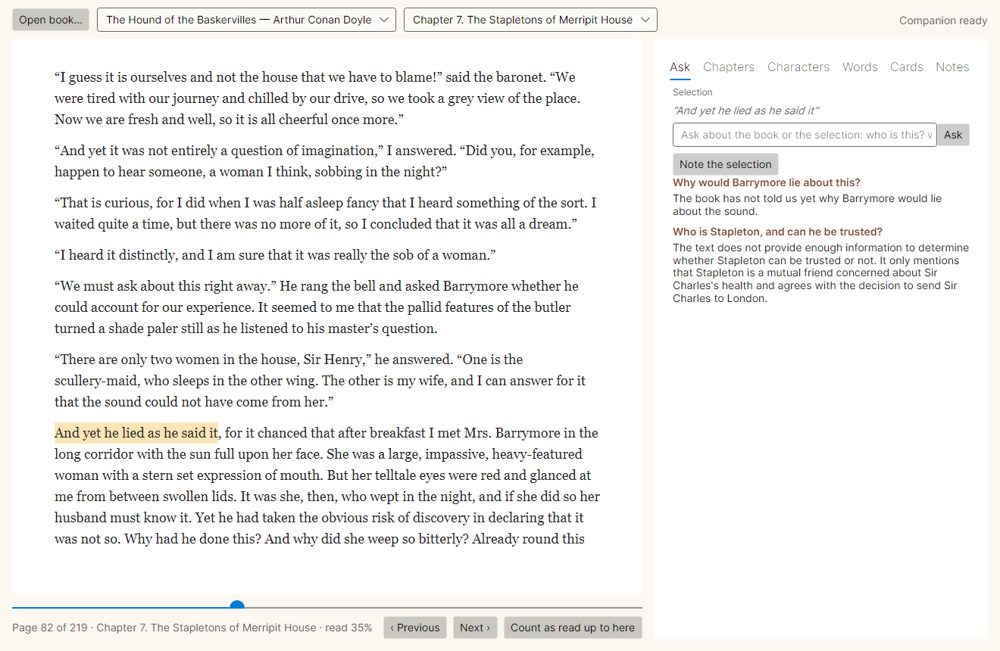
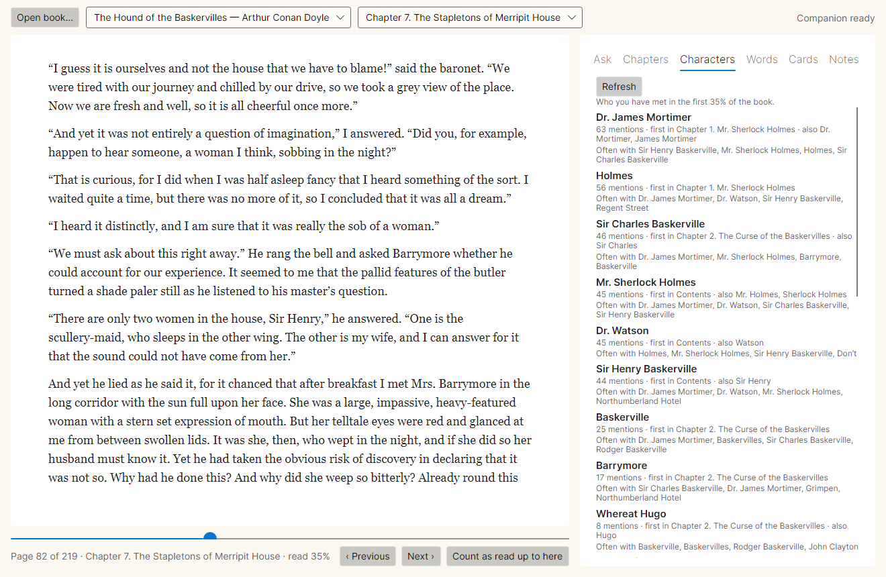
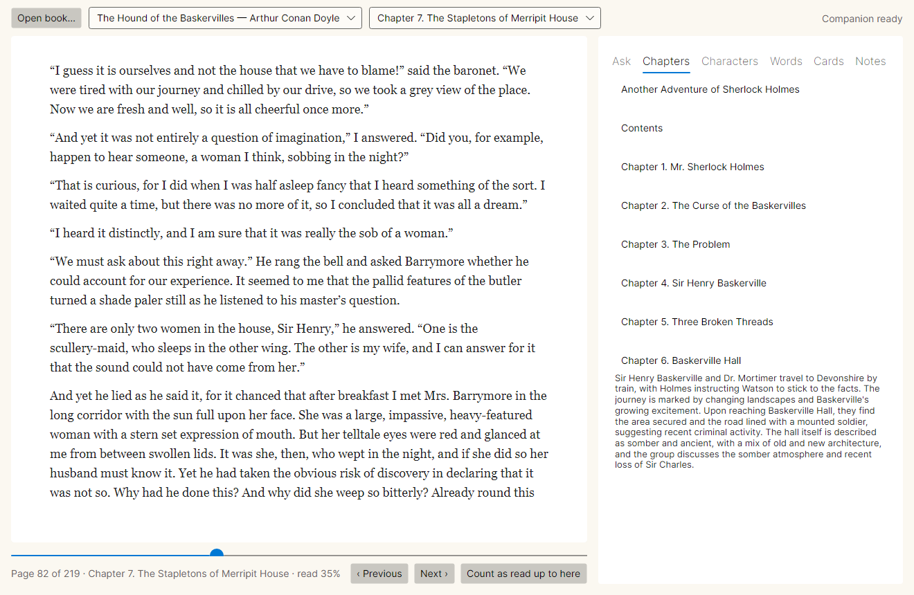
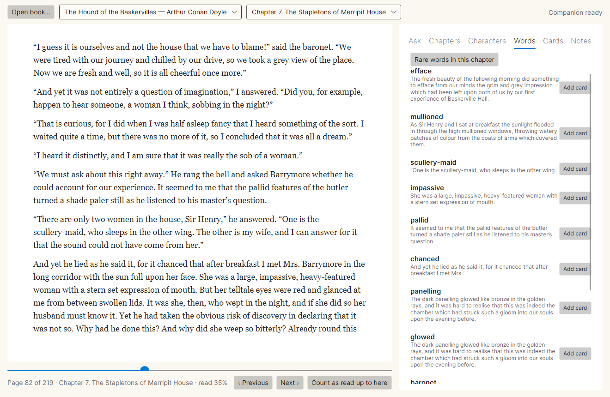

# Margin

An EPUB reader with a reading companion that has only read as far as you have.

Select a passage and ask "who is this?", "why did he lie?", "what was in the letter?". The companion
answers from the pages you have read and nothing after them. It recalls finished chapters, keeps a
map of the characters you have met so far, and collects rare words into flashcards. Everything runs
locally: a C# reader and a Python service, with a 7B language model in llama.cpp.



| Characters met so far | Chapters read, recalled | Rare words in the chapter |
|---|---|---|
|  |  |  |

## How it keeps spoilers out

A plain "chat with your book" tool retrieves from the whole book, and a language model may know the
book anyway. Margin closes both routes.

1. **Positions.** The reader (C#) parses the EPUB once into blocks with character offsets, and sends
   exactly that to the service as JSON. Both sides use the same positions, and no text is re-parsed
   on the Python side.
2. **The horizon.** The furthest position read is kept in SQLite. It only moves forward, and only
   when you turn pages from within what you have read, so jumping ahead through the contents does not
   count as reading. "Count as read up to here" moves it on purpose.
3. **One way to text.** The service reads the book only through a `Horizon` object. Asking it for
   text past the horizon raises `Spoiler`. Retrieval, summaries, the character map and vocabulary are
   all built through it:
   - retrieval scores only passages that end before the horizon, and the passage it falls in is cut
     at the horizon;
   - summaries exist only for finished chapters;
   - the character map counts only read text.
4. **The prompt.** It tells the model the reader is partway through the book and must not learn
   anything later, even if the model knows the book: "If the excerpts do not answer the question,
   say the book has not told us yet."
5. **The guard.** It checks every answer in two ways:
   - **unseen names:** a name in the answer that appears in the unread part of the book but not in
     the read part;
   - **closeness:** an answer sentence much closer, in embedding space, to an unread sentence than to
     any read one.

   If either check fires, the model is asked again, more strictly. If the second answer still fires,
   the companion says it would rather not answer yet.

The tests check these properties directly. For the five books, at 12 random horizons each, they
build every prompt and check that no 8-word run of text that exists only after the horizon appears
in any of them. They also check that search never returns an unread passage, that only finished
chapters get summaries, and that the character map at a horizon never names anyone met later.

## Results

The evaluation set ([bench/companion.jsonl](bench/companion.jsonl)) has 49 questions across five
public-domain novels:

- **27 spoiler questions**, asked at the start of a chapter before the book reveals the answer (who
  killed Mrs. Inglethorp, is Beryl Stapleton really Stapleton's sister, who does Elizabeth marry);
- **22 answerable questions**, asked after the book has given the answer.

The reader has just finished the chapter before and selects its last paragraph. The model is
Qwen2.5-7B-Instruct (Q4_K_M) in llama.cpp, temperature 0, on a GPU. The four conditions:

- **Model alone:** a plain assistant gets the title and the question, with no excerpts and no word
  about spoilers.
- **Whole-book retrieval:** the same plain assistant with the 6 closest passages from anywhere in
  the book.
- **Margin without the guard.**
- **Margin.**

Every one of the 196 answers was labelled by hand: did it reveal the secret, and did it give the
reference answer.

| | Spoiled (27) | Answered (22) | Median latency |
|---|---|---|---|
| Model alone | **52%** | 32% | 1.4 s |
| Whole-book retrieval | **67%** | 64% | 2.5 s |
| Margin without the guard | 0% | 50% | 2.0 s |
| Margin | **0%** | **55%** | 1.2 s |

- **The model knows these books.** It volunteers the murderer, the marriage and the twist when asked
  plainly. Its memory is also unreliable: it gave the wrong poison, invented a niece, and claimed
  Alfred Inglethorp was innocent. Retrieval over the whole book makes the answers more accurate, and
  that spoils even more.
- **Retrieval limited to what has been read** removes spoilers entirely here, and keeps most of the
  answering:
  - 50 to 55% of answerable questions answered, against 64% when the model can read ahead;
  - the misses are mostly answers that are nearly right but leave out the part the reference asks
    for, for example the summons but not the verdict.
- **The guard** held back 4 answers to spoiler questions, and no answer to an answerable question.
  None of the 4 would have spoiled anything: on this set the prompt alone already kept spoilers
  out, so the guard is a safety net here. The two Margin rows differ on answerable questions
  because answers vary slightly even at temperature 0 (llama.cpp reuses cached prompts), not because
  of the guard.
- **Latency.** Margin runs right after the unguarded version on the same prompt, so llama.cpp's
  prompt cache makes its median lower.

**The automatic judge.** A second model call (few-shot, same model) also judged every answer. It
agrees with the hand labels on 83% of the 196 answers and is mostly too strict: 29 answers judged
wrong or safe were right or revealing by hand, and 5 the other way. By the judge:

| | alone | whole book | Margin without the guard | Margin |
|---|---|---|---|---|
| spoiled | 48% | 41% | 0% | 0% |
| answered | 23% | 32% | 32% | 41% |

Hand labels are in [bench/judge-labels.jsonl](bench/judge-labels.jsonl), and every answer is in
[results/companion.json](results/companion.json).

## Features

- **Reader:** EPUB 2 and 3; spine, nav or NCX contents; Project Gutenberg boilerplate removed. Pages
  are laid out with greedy word wrap for the window size, and a page never ends on a heading. Library,
  contents, keyboard navigation, and position kept per book.
- **Ask:** select text and ask about it. Answers and questions are kept per book, with the horizon at
  which they were asked.
- **Chapters:** a summary of each finished chapter (long chapters are summarized in parts), made once
  and cached.
- **Characters:** names found in the read text and their forms merged ("Holmes", "Mr. Sherlock
  Holmes"), keeping titles apart ("Mrs. Inglethorp" is not "Alfred Inglethorp"). It shows mentions,
  the first chapter, and who they appear with, and grows as you read. This is heuristic: a
  sentence-initial archaism can stick to a name ("Whereat Hugo").
- **Words:** rare words in the current chapter (wordfreq Zipf below 3), with their sentence. "Add
  card" asks the model for the meaning in context and makes a flashcard.
- **Cards:** SM-2 spaced repetition (Again, Hard, Good, Easy).
- **Notes** on selections.

## Layout

```
src/Margin.Core      EPUB parsing, positions, pagination, SQLite library (horizon, notes, cards), service client
src/Margin.App       Avalonia desktop app
src/Margin.Cli       margin info|export <epub> (the book as the service sees it)
tests/Margin.Tests   22 tests: EPUB parsing (a built test book and the five books), pagination, library, SM-2, client
service/             Python companion: FastAPI on 127.0.0.1:8765, llama-server on :8090
  margin_service/    book.py (Horizon), index.py (passages, embeddings, search), guard.py, companion.py,
                     summaries.py, names.py + characters.py, vocabulary.py, server.py, evaluate.py
  tests/             15 tests: no unread text in any prompt, search, summaries, characters, vocabulary, guard, API
bench/               the 49 questions and the hand labels
data/books/          five Project Gutenberg EPUBs (public domain)
```

## Running it

Requirements: .NET 10 SDK, Python 3.14, and an NVIDIA GPU for the 7B model. Use `--cpu` and the 3B
model otherwise; it is slower and weaker.

```bash
scripts/fetch-deps.sh --llm
```

```bash
cd service && python -m venv .venv && .venv/Scripts/pip install -r requirements.txt --index-url https://download.pytorch.org/whl/cu128 --extra-index-url https://pypi.org/simple
```

```bash
dotnet run --project src/Margin.App -c Release
```

The app starts the service itself (`service/.venv`) and stops it when it closes. Opening a book the
first time indexes it (passage and sentence embeddings), and the index is cached. Set `MARGIN_LLM_MODEL` to use another GGUF
model.

Tests:

```bash
dotnet test tests/Margin.Tests
```

```bash
scripts/export-books.sh && cd service && .venv/Scripts/python -m pytest -q
```

The evaluation is run with `python -m margin_service.evaluate` from
`service/`. `--summarize` recomputes the tables from the saved answers and hand labels.

## Licenses

Margin is MIT ([LICENSE](LICENSE)). It uses:

| Component | License |
|---|---|
| The five books in `data/books` (Project Gutenberg) | public domain in the USA |
| Qwen2.5-7B-Instruct | Apache 2.0 |
| Qwen2.5-3B-Instruct (optional) | Qwen Research License |
| BAAI/bge-small-en-v1.5 | MIT |
| llama.cpp | MIT |
| Avalonia, HtmlAgilityPack, Microsoft.Data.Sqlite | MIT |
| wordfreq | Apache 2.0 (code), CC BY-SA 4.0 (data) |

The model is downloaded by `fetch-deps.sh`, and the embedding model is downloaded on first use; neither
is kept in this repository.
